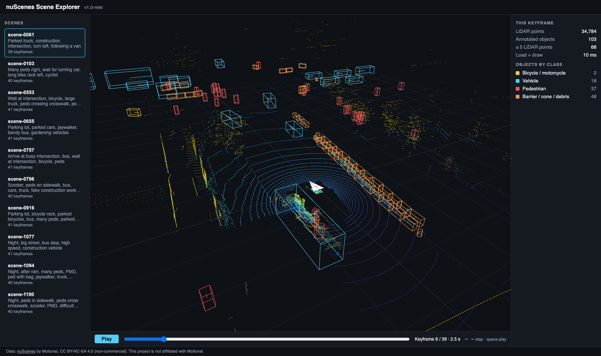

# nuScenes Scene Explorer

A browser tool for exploring the [nuScenes](https://www.nuscenes.org) autonomous-driving dataset: LiDAR point clouds and 3D annotations on a keyframe timeline, built with **Vue 3, TypeScript and Three.js**. The goal is the kind of web tooling ML and annotation teams use to inspect driving data, catch bad labels, and see where perception models are confidently wrong.

> nuScenes is © Motional and licensed **CC BY-NC-SA 4.0 (non-commercial)**. This is an independent, non-commercial portfolio project, not affiliated with Motional. The dataset is never committed to this repo.

## Status

| Milestone | Scope | Status |
|---|---|---|
| M1 | Scene list, 2 Hz keyframe timeline (scrub, play, arrow keys), LiDAR point cloud coloured by height, 3D boxes coloured by class with heading, per-keyframe stats | **Done**, runs on nuScenes v1.0-mini (2026-10-24) |
| M2 | Six camera views with projected boxes; click a box to highlight it in every view | Planned |
| M3 | Annotation QA: flag boxes with very few LiDAR points or low visibility, review queue with shortcuts, export | Planned (the low-evidence count is already shown) |
| M4 | Load a nuScenes-format detection results file, match predictions to ground truth, highlight high-confidence false positives and misses | Planned |
| M5 | Performance pass (Web Worker parsing, measured load time and FPS) and a design doc update | Planned |


*scene-0061, keyframe 6 of 39, from nuScenes v1.0-mini. Data: nuScenes by Motional, CC BY-NC-SA 4.0.*

**Measured on v1.0-mini (2026-10-24, MacBook):** the converter turned 10 scenes / 404 keyframes / 14.0 M LiDAR points / 18,538 boxes into browser files in 1.9 s (219 MB). A typical keyframe has about 34,800 points and 100 boxes, and in scene-0061 68 of 103 boxes have 5 or fewer LiDAR points (the low-evidence labels M3 will queue). Load and draw of one keyframe: 10 ms on the local dev server.

## Run it

```bash
npm install
npm run demo-data        # writes a small SYNTHETIC fixture to public/data (the app labels it as synthetic)
npm run dev
```

### With real nuScenes data
1. Create an account at nuscenes.org, accept the terms, and download **v1.0-mini** (metadata + keyframe blobs).
2. Convert it to the browser format:
   ```bash
   pip install -r preprocess/requirements.txt
   python preprocess/convert_nuscenes.py --dataroot /path/to/nuscenes --version v1.0-mini --out public/data
   ```
3. `npm run dev`. `public/data/` is git-ignored.

## How it works

```
nuScenes (JSON tables + .pcd.bin)  ──preprocess/convert_nuscenes.py──▶  public/data/
                                                                          index.json
                                                                          samples/<token>.json   boxes in the LIDAR_TOP frame
                                                                          lidar/<token>.bin      float32 x, y, z, intensity
Browser:  data.ts (fetch + cache + prefetch next 3) ─▶ App.vue (scene / keyframe state)
          ─▶ SceneRenderer.ts (Three.js: one reused BufferGeometry for points, one for all box edges)
```

- `src/geometry.ts`: box corner maths matching the devkit's `Box.corners()` order, unit-tested in `src/geometry.test.ts`.
- `src/viewer/SceneRenderer.ts`: z-up camera to match nuScenes sensor frames; keyframe changes rewrite typed arrays instead of allocating scene objects.
- `src/App.vue`: drops late responses when the user scrubs quickly, and measures load-and-draw time per keyframe.

Design notes: [docs/DESIGN.md](docs/DESIGN.md).

## Scripts

| Command | Does |
|---|---|
| `npm run dev` | Dev server |
| `npm run build` | Type-check (vue-tsc) and production build |
| `npm test` | Unit tests (Vitest) |
| `npm run demo-data` | Synthetic fixture for development |
